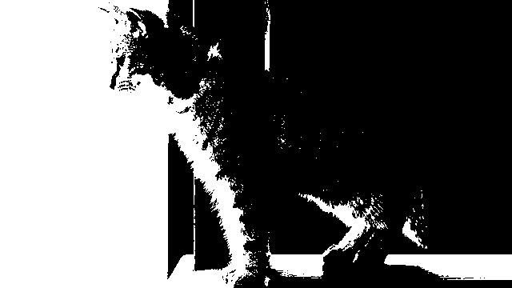

# pixelforge

[](https://github.com/Pamirus/pixelforge/actions/workflows/ci.yml)

A small command-line photo filter program, and a lab for measuring what modern C++ techniques really cost.

pixelforge loads a photo, applies filters such as grayscale, brightness, blur or threshold, and saves the result. The program is rewritten in stages. It starts as plain C with `malloc` and `free`, then moves through RAII, move semantics, views, templates, concepts, data layout, parallelism and lazy evaluation. Each stage gets a git tag (`v0`, `v1`, …) and a benchmark, so any two stages can be compared.

**Status:** v0 (the C baseline), v1 (an `Image` class built on RAII), v2 (copying versus moving), v3 (views, flips and rotation), v4 (templates for 8-bit and `float` pixels, box blur) and v5 (work moved to compile time) and v6 (concepts, compared with `std::enable_if`) and v7 (four ways to choose a filter, plus sharpen and Sobel) and v8 (memory layout and the vectorization report) and v9 (loops against STL algorithms and ranges, lazy filter chains) and v10 (threads, a data race, a filter factory and a decorator) and v11 (a script that measures every tag, memory- against compute-bound, a note on GPUs) are done. All stages of the plan are complete; the final write-up is in [docs/summary.md](docs/summary.md). The plan is in [docs/ROADMAP.md](docs/ROADMAP.md).

## Usage

Filters run in the order given:

```sh
build/src/pixelforge images/cat-4k.jpg out.jpg --grayscale --brightness 20
```

| Option | Effect |
|---|---|
| `--grayscale` | Replaces R, G and B with their average |
| `--brightness N` | Adds N (−255 to 255) to every channel |
| `--negative` | Replaces every channel value v with 255 − v |
| `--threshold N` | Makes pixels with a gray level of at least N (0 to 255) white, the rest black |
| `--flip-horizontal` | Mirrors the image left to right |
| `--flip-vertical` | Mirrors the image top to bottom |
| `--rotate` | Turns the image 90° clockwise; repeat it for 180° or 270° |
| `--blur N` | Box blur: replaces each pixel with the average of the pixels up to N (1 to 10) away, a (2N+1) × (2N+1) square |
| `--sharpen` | Makes edges crisper: five times each pixel minus its four neighbours |
| `--sobel` | Edge detection: bright where the gray level changes fast, black in flat areas |
| `--time` | Prints how long loading, each filter and saving take |

The output format follows the extension: `.png`, `.jpg` or `.bmp`. The C baseline, `build/baseline_c/pixelforge_c`, takes the same arguments but has only grayscale and brightness.

| Original | `--grayscale` | `--brightness 60` |
|---|---|---|
|  |  |  |

| `--negative` | `--threshold 110` | `--blur 3` |
|---|---|---|
|  |  |  |

Photo: "Young tabby cat keeping watch" by W.carter, CC0 ([details](images/README.md)).

## Building

Needs CMake 3.25 or newer and a C++20 compiler.

```sh
cmake -B build        # Release unless CMAKE_BUILD_TYPE says otherwise
cmake --build build
ctest --test-dir build --output-on-failure
```

The first configure downloads GoogleTest and Google Benchmark. Pass `-DPIXELFORGE_BUILD_TESTS=OFF` or `-DPIXELFORGE_BUILD_BENCHMARKS=OFF` to skip them.

## Results

Machine: Apple A18 Pro (6 cores, 8 GB), Apple Clang 21, Release build (`-O3`). On this laptop timings vary from run to run and even more from day to day: on 2026-11-13 the v0 benchmark gave 6.2 ms and 3.1 ms. So only rows measured in the same session are compared, and a whole table is measured again whenever a row is added.

### Filters

Time for one filter pass over the 3840 × 2160 photo (24.9 MB in memory):

```sh
build/baseline_c/pixelforge_c_bench images/cat-4k.jpg 200   # v0
build/benchmarks/pixelforge_bench images/cat-4k.jpg 200      # v1 and later, built from that tag
```

| Tag | Version | Grayscale | Brightness |
|---|---|---|---|
| v0 | C, `malloc`/`free` | 6.3 ms | 3.0 ms |
| v1 | C++ `Image` class: RAII, `std::vector`, exceptions | 6.1 ms | 2.5 ms |
| v4 | The same filters as templates for 8-bit and `float` pixels | 6.2 ms | 2.5 ms |

Each benchmark run times 200 passes and reports their median. The three benchmarks were run one after the other, three times each, on 2026-11-20; the table shows the middle of the three medians. Another program kept one of the six cores busy throughout, and every row was 35 to 55% slower than on 2026-11-16, when v0 and v1 took 4.1 ms each for grayscale and 2.2 and 1.8 ms for brightness. The rows kept the same order. v2 and v3 did not change these two filters, so they have no rows here.

- **Grayscale** is the same in C and C++. Keeping the pixels in a class with a `std::vector` costs nothing measurable.
- **The v4 templates** cost nothing either. For 8-bit pixels the compiler turns them into exactly the same machine code as the v1 functions, instruction for instruction, so the v4 row differs from the v1 row only by noise.
- **Brightness** was 16 to 22% faster in C++ in every round. Both versions process 16 bytes at a time, but their inner loops differ. In C++, `std::clamp(v, 0, 255)` becomes four max and four min instructions for each 16 bytes, on vectors of four 32-bit numbers (the bytes are widened first; this sentence first said one max and one min, which the assembly does not show, see [docs/memory-vs-compute.md](docs/memory-vs-compute.md)). In C, the two `if`s in `clamp_to_byte` become a mask and extra shuffle steps: 23 instructions per 16 bytes instead of 19. That is the likely cause, and it comes from the code the compiler chose, not from the language. Stage v9 compares assembly in detail.
- **Grayscale takes more than twice as long as brightness**, although both touch the same 24.9 MB. The compiler did not vectorize the grayscale loop: it handles one 3-byte pixel per turn, while the brightness loop works on 16 bytes at a time. Stage v8 looks into why.

### Copying versus moving (v2)

```sh
build/benchmarks/pixelforge_benchmarks --benchmark_repetitions=5
```

| Operation on a 3840 × 2160 image (24.9 MB) | Time |
|---|---|
| Copy into a new image | 0.9 ms |
| Copy into an existing image of the same size | 1.0 ms |
| Copy into a new image, first time in a fresh process | 5.5 ms |
| Move to another image and back (two moves) | 1.5 ns |

Measured on 2026-11-18. The first-copy row is the median of five separate processes, which ranged from 3.8 to 9.2 ms; each other row is the middle of three runs of five repetitions. Between repetitions the times varied by 10 to 20%, so 0.9 and 1.0 ms count as the same.

- **A move costs about a nanosecond, whatever the image size.** It hands over a pointer and two sizes; the 24.9 MB stay where they are. A copy reads and writes all of them, which takes about a million times longer.
- **A repeated copy into a new image costs no more than one into an existing image**, although it allocates 24.9 MB each time. macOS's allocator keeps the large block the previous copy freed and hands it out again with its memory pages already in place. With that cache turned off (`MallocLargeCache=0`), the same copy took 2.75 ms.
- **The first copy in a process is the slow one.** Its memory is new, and the system sets up each 16 KB page the first time it is written: about 1,500 pages for one image.
- **Which returns copy and which move** is checked in [tests/return_value_test.cpp](tests/return_value_test.cpp). Returning a temporary or a single named image costs nothing; `return std::move(image)` costs a move; `return first ? a : b` costs a copy.

### Views, flips and rotation (v3)

```sh
build/benchmarks/pixelforge_benchmarks --benchmark_filter='crop|flip|rotate' --benchmark_repetitions=5
```

| Operation on a 3840 × 2160 image (24.9 MB) | Time |
|---|---|
| Crop the middle quarter as an `ImageView` | 2.8 ns |
| Copy that crop (1920 × 1080, 6.2 MB) into a new image | 0.33 ms |
| Flip top to bottom (`--flip-vertical`) | 0.72 ms |
| Flip left to right (`--flip-horizontal`) | 10.5 ms |
| Rotate 90° into a new image (`--rotate`) | 16.1 ms |

Measured on 2026-11-19; each row is the middle of three runs of five repetitions. Between the runs the same row varied by as much as 60% (the vertical flip took 0.67 to 1.05 ms), so the numbers are rough, but the gaps between the rows are much larger.

- **A crop costs a few nanoseconds, whatever its size.** It works out one pointer and checks four numbers. Copying the same region takes about 100,000 times longer, so a crop is copied only when it has to outlive the image or be saved on its own.
- **The two flips move the same 24.9 MB, but the vertical one is about 15 times faster.** It swaps whole rows, and the compiler turns that into 32-byte vector loads and stores. The horizontal flip swaps one 3-byte pixel at a time, with single-byte loads and stores. That is the likely cause; stage v8 measures it.
- **The rotation is the slowest, although it also reads and writes each byte once.** It builds each row of the result from a column of the image, so consecutive reads are a whole row (11,520 bytes) apart instead of next to each other. It also allocates the new image each time. Stage v8 is about this kind of memory access order.

### Pixel types and blur (v4)

```sh
build/benchmarks/pixelforge_benchmarks --benchmark_filter='grayscale|brightness|convert|blur' --benchmark_repetitions=5
```

| Operation on a 3840 × 2160 image | 8-bit pixels (24.9 MB) | `float` pixels (99.5 MB) |
|---|---|---|
| Grayscale | 6.1 ms | 5.7 ms |
| Brightness +20 | 2.7 ms | 3.8 ms |
| Convert into a new image of the other type | 5.2 ms | 5.6 ms |
| Box blur, radius 1 (3 × 3 window) | 74 ms | 67 ms |
| Box blur, radius 2 (5 × 5 window) | 210 ms | 170 ms |
| Box blur, radius 5 (11 × 11 window) | 840 ms | 850 ms |

Measured on 2026-11-20, right after the filter table above; each cell is the middle of three runs of five repetitions. Between the runs the same cell varied by as much as 65% (converting to 8-bit took 5.4 to 9.0 ms), so only large gaps mean something.

- **Grayscale takes no longer on `float` pixels, although they are four times the bytes.** The compiler vectorized neither version: both loops handle one pixel per turn, with three loads, the average and three stores. So the time follows the number of pixels, not the number of bytes.
- **Brightness is vectorized for both types and takes 40% longer on `float` pixels.** For four times the bytes, that is 26 GB/s instead of 9 GB/s.
- **Converting to `float` and back costs about 11 ms, nearly twice a grayscale pass.** That is worth paying for a chain of filters, converted once at each end, because no filter in the chain rounds its result; for one quick filter it is not.
- **The blur takes more than ten times as long as grayscale even at radius 1, and its time grows with the window, not the radius.** From radius 1 to 5 the window grows from 9 to 121 pixels and the time by 11 to 13 times. Every pixel reads its whole window, at just under 1 ns per neighbour. Stage v8 moves the border checks out of the inner loop.
- **The blur takes about as long on `float` pixels as on 8-bit ones**, so memory traffic is not what limits it; the work for each neighbour is.

### Compile time (v5)

```sh
build/benchmarks/pixelforge_benchmarks --benchmark_filter='blur|brightness' --benchmark_repetitions=5 --benchmark_enable_random_interleaving=true
```

| Operation on a 3840 × 2160 image | v4: chosen at run time | v5: fixed at compile time |
|---|---|---|
| Box blur 3 × 3, 8-bit pixels | 105 ms | 69 ms |
| Box blur 5 × 5, 8-bit pixels | 250 ms | 145 ms |
| Box blur 11 × 11, 8-bit pixels | 1,210 ms | 930 ms |
| Box blur 3 × 3, `float` pixels | 119 ms | 50 ms |
| Box blur 5 × 5, `float` pixels | 310 ms | 121 ms |
| Box blur 11 × 11, `float` pixels | 1,270 ms | 670 ms |
| Brightness +20, 8-bit pixels: computed, or looked up in a table | 4.7 ms | 11.9 ms |

The v4 column is `box_blur(image, radius)` and the computed brightness; the v5 column is `Blur<Size>` and `brightness_lookup`, whose table comes from the `constexpr` function `brightness_table`. Measured on 2026-11-21, shortly after midnight, while other programs kept about two of the six cores busy; each cell is the middle of three runs of five repetitions. So the times are higher than in the v4 table, and between runs the same cell varied by more than 80%. To keep the comparison fair, the repetitions of all rows ran in random order, and in every run each v5 blur was faster and the table slower than its v4 counterpart.

- **Fixing the blur size at compile time made the blur 1.3 to 2.6 times faster**, least for the largest window. For `Blur<3>` the compiler unrolls the whole 3 × 3 window: on 8-bit pixels its code has 33 single-byte loads, against 3 inside the loops of `box_blur`. Larger windows are unrolled only in part (18 loads for 11 × 11), and gain less. The price is that every size is separate code and must be known when the program is compiled, so `--blur N` keeps the run-time version.
- **The lookup table made brightness about 2.5 times slower.** The computed version is vectorized: it loads 16 bytes at a time, widens them to 32 bits and clamps them with four max and four min on four-lane vectors (the first version of this sentence said one max and one min). A table lookup cannot be vectorized this way, so that loop loads each byte, loads its table entry and stores it, one byte at a time. Building the table takes 256 steps and does not matter. A table would pay off for a costlier formula per value, such as a gamma curve.

The differences between 8-bit and `float` channels, such as rounding and the largest value, live in one traits class, [channel_traits.hpp](include/pixelforge/detail/channel_traits.hpp). Up to v4 it had one specialization per type; v5 makes it a single template whose functions choose their 8-bit or `float` code with `if constexpr`. The compiler throws the other branch away, and the filters compile to the same object file as before, byte for byte.

For two types that differ in a few short functions, the `if constexpr` version reads better: each operation shows both versions next to each other, so the differences are easy to see. The specializations still have two advantages. Each type's rules are in one block, and the type aliases stay plain (`using Work = int;` instead of `std::conditional_t<is_8_bit, int, float>`). A third channel type, such as 16-bit, would also be a new specialization that leaves the others alone, while with `if constexpr` it would add a branch to every function.

### Concepts (v6)

The filter chain `apply(image, filters...)` accepts only types that have a `const` member `apply(image)`. It is written twice: `apply_enable_if` with `std::enable_if` and a `std::void_t` trait, and `apply` with the concept `FilterFor<F, T>`. Tests check at compile time that both accept and reject exactly the same types.

What differs is what the compiler says about a wrong call. Apple Clang 21 names the failing filter and the reason for the concept version (`no member named 'apply' in 'NotAFilter'`), and only the filter for the `enable_if` one. g++ 15.2 reports the concept as one unit over all the filters, without the filter or the reason, but still better than the `enable_if` version, which ends inside `<type_traits>` with `no type named 'type' in 'struct std::enable_if<false, void>'`. So the difference between the two compilers was larger than the difference between the two techniques. The messages and a script to reproduce them are in [docs/error-messages](docs/error-messages/README.md).

### Polymorphism (v7)

```sh
build/benchmarks/pixelforge_benchmarks --benchmark_filter='chain|call' --benchmark_repetitions=5 --benchmark_enable_random_interleaving=true
```

Three filters (brightness, grayscale, negative) are written once as small function objects in [poly.hpp](include/pixelforge/poly.hpp), and four ways of choosing which one runs wrap the same loops: a `virtual` function, CRTP, a `std::variant` and a `std::function`. The benchmark applies all three in a row to a tiny image, where the cost of finding the filter would show, and to the 4K image.

| Chain of three filters | 16 × 9 pixels (432 bytes) | 3840 × 2160 |
|---|---|---|
| Called by name, nothing chosen | 114 ns | 6.4 ms |
| CRTP | 113 ns | 6.5 ms |
| `virtual` | 123 ns | 7.0 ms |
| `std::variant` | 123 ns | 7.1 ms |
| `std::function` | 123 ns | 7.1 ms |

Measured on 2026-11-21, 16:55 to 16:58; each cell is the middle of three runs of five repetitions, with the repetitions of all rows in random order. The machine did not get quiet: for 15 minutes before the runs, background services (`mobileassetd`, `coreduetd`) used 25 to 40% of a core, and right after the runs the busiest process used 0.6%. Between the runs, the same cell varied by up to 8% (the direct call took 112 to 121 ns), which is as much as most of the gaps.

- **The four ways cost about the same.** On the tiny image the whole difference between the fastest and the slowest is 10 ns for three calls, and that is in the range of the run-to-run spread. Even the real cost of an indirect call is a few nanoseconds, against loops that take 24.9 MB of work or more on a photo.
- **The 4K gaps of about 10% are not the cost of the calls.** Three calls cost nanoseconds and the gap is half a millisecond. When the compiler can see the loops (the first two rows), it may optimize them differently from loops it reaches through a pointer. That is a guess; the assembly of the loops was not compared.
- **What the four ways allow differs more than what they cost.** `virtual` and `std::function` build a list at run time and accept new filters without changing the code that applies them; `std::variant` also builds a list at run time but needs the whole set of filters named in one place; CRTP needs the chain written out in the code and has no common base class, but its filters also fit the v5 chain (`apply(image, filters...)`). The command line needs a run-time list, so the filters in `filters.hpp` stay `virtual`.
- **`final` does devirtualize, and it helps little.** One call through a pointer that the compiler cannot see through took 9.5 to 10.0 ns when the class could have subclasses, and 9.35 to 9.50 ns when the class is `final`. In the assembly (Apple Clang 21), the first has one indirect call (`blr`) and the second none: the compiler calls the function directly and inlines it. The gain is about half a nanosecond, because a well-predicted indirect call is cheap on this processor. This answers the question left open in v5: the `apply` of the filter classes is devirtualized only where the compiler knows the object has a `final` class.

`--sharpen` and `--sobel` are new as well: a 3 × 3 sharpening kernel and the Sobel edge detector, which draws only the places where the gray level changes fast.

### Memory layout (v8)

```sh
build/benchmarks/pixelforge_benchmarks --benchmark_filter='planar|interleaved|flip|clipped' --benchmark_repetitions=5 --benchmark_enable_random_interleaving=true
```

All numbers are for the 3840 × 2160, 8-bit image, the middle of three runs of five repetitions with the repetitions in random order. The machine was **not quiet** in the layout and flip runs: VS Code's `cpptools` used about 96% of one core during both (and `godot` 99% at the end of the flip run), so those two tables are noisier than the blur table, which was measured on 2026-11-22 after about five minutes of waiting for quiet.

**Interleaved against planar** (`PlanarImage` keeps three planes `RRR…GGG…BBB…` in one block; measured 2026-11-21, 21:42 to 21:44):

| Operation | Interleaved `Image` | Planar `PlanarImage` |
|---|---|---|
| Grayscale | 7.00 ms | 2.92 ms (2.4×) |
| Brightness, all channels | 2.77 ms | 2.75 ms |
| Brighten only the red channel | 4.43 ms | 1.01 ms (4.4×) |
| Convert to the other layout | 1.42 ms | 1.38 ms |

**Flips** (2026-11-21, 22:48 to 22:49):

| Operation | Time |
|---|---|
| Copy into an existing image (reference) | 0.96 ms |
| Vertical flip | 0.90 ms |
| Horizontal flip, pixel by pixel | 7.78 ms |
| Horizontal flip, 16-pixel blocks | 5.52 ms |

**Box blur with the window clipped once per pixel** (`box_blur_clipped`, 2026-11-22, 11:04 to 11:07; the same pixels as `box_blur`, checked by tests):

| Radius | 8-bit `box_blur` | 8-bit clipped | `float` `box_blur` | `float` clipped |
|---|---|---|---|---|
| 1 (3 × 3) | 63.7 ms | 43.7 ms | 55.1 ms | 35.6 ms |
| 2 (5 × 5) | 174 ms | 95.4 ms | 119 ms | 80.8 ms |
| 5 (11 × 11) | 767 ms | 418 ms | 624 ms | 469 ms |

- **Planar wins when only some channels are touched, or when the loop needs all three.** Brightness over all values is the same loop over contiguous bytes in both layouts, so it takes the same time. Brightening one channel is 4.4 times faster in planar form, although the interleaved loop walks 3 times as many bytes: so the memory traffic is not all of it. The likely cause, not isolated, is that the compiler vectorizes the planar loops and not the interleaved ones. Converting costs about 1.4 ms each way, less than one interleaved grayscale, so it pays off when several channel-wise filters follow. *Update (v12): for grayscale this was mostly not the layout. With a loop that counts pixels and a division by 3 written as a multiplication, interleaved grayscale went from 6.52 to 1.82 ms and planar from 3.08 to 1.50 ms (2026-11-28, busy machine), so planar is now 1.2 times faster, not 2.4. For one channel planar is still 2.8 times faster ([docs/vectorization.md](docs/vectorization.md#update-v12-the-interleaved-loops-count-pixels)).*
- **The grayscale loop is not vectorized because of its shape, not its layout.** The report ([docs/vectorization.md](docs/vectorization.md)) says "uncountable loop": the counter steps by 3 and could wrap. A separate test function that counts pixels instead of bytes vectorizes. I did not put that change in the library, and I did not measure how much faster it is. *Update (v12): done; see the note above.*
- **The earlier guess about the flips was half right.** The horizontal flip is 8.6 times slower than the vertical one in this run (the v3 table said about 15 times; the machine and the load were different, so "roughly 8 to 15 times" is what I can say). It is not the memory access pattern: both flips walk memory in order, and copying the same 24.9 MB takes about 1 ms. In the assembly the horizontal flip has no vector instruction and 12 single-byte operations per swapped pixel, so it is bound by instructions. Processing 16-pixel blocks helps only 1.4 times, because the compiler still moves bytes one at a time. A flip written with NEON reverse instructions was not tried, so "scalar code is the cause" rests on the assembly and the copy reference, not on a fast version.
- **Moving the border test out of the blur gives 1.3 to 1.8 times.** Even then a 4K blur at radius 5 takes 0.4 to 0.5 s, about 0.4 ns per neighbour for 8-bit. The inner loop sums a window of only a few pixels per row, so vectorizing it has little to work with; the gain likely comes from removing the test, not from vectorization (the report was not mapped line by line to the two pixel types). A blur that adds up a running sum instead of re-reading the window was not tried.
- **I have not looked at the rotation's access order yet.** The v3 text says it reads a column at a time; that was not measured in this stage.

### Zero-cost abstraction (v9)

```sh
build/benchmarks/pixelforge_benchmarks --benchmark_filter='negative_|chain_(step|lazy)' --benchmark_repetitions=5 --benchmark_enable_random_interleaving=true
```

All numbers: 3840 × 2160, 8-bit, middle of three runs of five repetitions with the repetitions in random order.

**The negative three ways** ([negative_variants.hpp](include/pixelforge/negative_variants.hpp); measured 2026-11-22, 22:47 to 22:48):

| Version | Time |
|---|---|
| Raw loop | 0.70 ms |
| `std::transform` with a lambda | 0.61 ms |
| `std::ranges::copy` of a `views::transform` | 0.71 ms |

**A chain of three filters** (brightness, negative, brightness; [lazy.hpp](include/pixelforge/lazy.hpp); measured 2026-11-23, 04:05 to 04:06):

| Version | Time |
|---|---|
| Three passes in place | 5.84 ms |
| Three passes, a new image per step | 9.67 ms |
| Lazy chain, one pass from the source to a result image | 5.81 ms |

Both runs were on a machine that did not get quiet: the first with `godot`, `cpptools` and simulator services using 70 to 95% of a core each, the second with `cpptools` at 99% of one core for the whole time. Within the first table the single runs ranged from 0.57 to 1.06 ms, which is as much as the gaps.

- **The three ways of writing the negative are the same machine code in the part that matters.** [docs/abstraction-assembly.md](docs/abstraction-assembly.md) compares them: each is a loop of two 16-byte loads, four `mvn`, two stores per 64 bytes, then an 8-byte loop and a byte loop for the end; no calls, the lambda and the view are inlined. That is why the times agree. It was checked for Apple Clang 21 at `-O3`, for one filter that reads and writes the same place; GCC was not run, nor a Debug build, where the lambda and the iterators are real calls.
- **An expression template computes the whole chain in one pass, but that did not beat three in-place passes here.** The lazy chain took 5.81 ms and the three in-place passes 5.84 ms. It was 1.7 times faster than making a new image per step. I expected the single pass to win; why it does not I did not find out. Guesses, not tested: the 24.9 MB may stay partly in the cache between the in-place passes, and the lazy chain moves two buffers (source and result) where the in-place chain moves one. Float images, longer chains and an image larger than the cache were not tried.
- **My first lazy chain was four times slower, and the reason is a lesson about `uint8_t`.** It took 18.5 ms against 4.5 ms for the three passes. The report of the compiler said "cannot identify array bounds" and the loop was not vectorized: the loop read the source pointer and the filter objects through `this`, and a store through a `uint8_t*` may change any object, so the compiler had to read them again after every store. Copying them into local variables before the loop made it vectorize, and the time came down to the 5.8 ms above. The cause is supported by the report and by the fix, but I did not look at the slow assembly line by line.
- **Only pointwise filters can be fused this way.** Brightness and negative change a value from its own old value. A blur reads neighbours and a flip writes elsewhere, so they would need more than this chain.

### Parallelism and patterns (v10)

```sh
build/benchmarks/pixelforge_benchmarks --benchmark_filter='parallel_|histogram_' --benchmark_repetitions=5 --benchmark_enable_random_interleaving=true
```

**Threads, not OpenMP.** The plan said OpenMP. Apple Clang has no `-fopenmp`, and `libomp` is not installed on the development machine, so the work is split by hand with `std::thread` ([parallel.hpp](include/pixelforge/parallel.hpp)): one equal piece per thread, the calling thread takes the last one. The idea is the same as `#pragma omp parallel for`, and it builds on both CI compilers. The Mac has six cores: two fast and four power-saving ones, so more threads do not add equal steps.

All numbers: 3840 × 2160, 8-bit, wall-clock time, the middle of three runs of five repetitions with the repetitions in random order. **The machine was not quiet in either run** (2026-11-23, 07:45 and 09:04): `cpptools` used 83 to 135% of a core, `godot` up to 83%, and `wait_idle` never saw quiet in 15 minutes. Single runs of the same cell differed by up to 30% (brightness on two threads: 9.1 to 12.0 ms), so the gaps below of less than that are not worth reading into.

**Filters on 1 to 6 threads** (milliseconds; the results equal the serial filters' for every thread count, checked in the tests):

| Threads | 1 | 2 | 3 | 4 | 5 | 6 |
|---|---|---|---|---|---|---|
| Brightness | 4.0 | 10.8 | 8.6 | 8.4 | 8.6 | 7.7 |
| Grayscale | 4.5 | 8.1 | 7.5 | 6.1 | 6.0 | 5.0 |
| Blur, radius 2 | 210 | 116 | 95 | 84 | 76 | 77 |

**Histogram of the gray levels** (milliseconds; "noise" is a pseudo-random image, "flat" has one gray level everywhere; the serial version takes 8.4 and 8.0):

| Version | Image | 1 thread | 2 | 4 | 6 |
|---|---|---|---|---|---|
| Racy (plain `++` on shared counters) | noise | 7.7 | 22.4 | 30.8 | 30.3 |
| Racy | flat | 8.6 | 11.2 | 6.4 | 6.9 |
| Atomic counters | noise | 11.4 | 55.5 | 136 | 83.4 |
| Atomic counters | flat | 23.3 | 50.1 | 92.6 | 128 |
| Private counters per thread | noise | 8.3 | 6.2 | 3.4 | 3.3 |
| Private counters per thread | flat | 8.9 | 7.1 | 4.8 | 4.8 |
| Private counters, laid out for false sharing | noise | 9.3 | 22.0 | 22.8 | 18.7 |
| Private counters, laid out for false sharing | flat | 9.5 | 10.6 | 6.6 | 5.8 |

- **Only the blur gets faster with threads, and only 2.5 to 2.8 times with five or six.** The blur does a lot of work per byte, so the threads do not wait for memory. Brightness and grayscale are the opposite: one thread already finishes a pass in 4 to 5 ms, and with more threads they got *slower*. My guess is the cost of starting new threads on every call; I did not test it, and a thread pool that is started once might change it. (I first guessed six cores sharing the memory as well, but stage v11 found that the library's brightness uses only about a third of the memory speed, see [docs/memory-vs-compute.md](docs/memory-vs-compute.md).)
- **The racy histogram loses counts.** It is undefined behaviour and was written only to be measured. On a flat 1000 × 1000 image with four threads it counted 233,009, 493,361 and 405,121 of 1,000,000 pixels in three runs. In the 4K benchmark it lost 1.2 to 2.8 million of 8.3 million counts on the noise image and 4 to 6 million on the flat one; the lost number changes from run to run. ThreadSanitizer reports the race in this version and in none of the others. The tests do not call it, because a test that needs a race to go wrong would be flaky.
- **Atomic counters are correct and the slowest.** Every `++` is one atomic instruction on a counter that other cores also want, and from two threads on the version is slower than the serial one, up to 16 times (136 ms against 8.4 ms) on the noise image.
- **Private counters, merged at the end, are the fastest and the only version that scales:** 3.3 ms on six threads, 2.6 times faster than the serial 8.4 ms, not 6 times. They are correct, and ThreadSanitizer finds nothing.
- **False sharing costs a lot on the noise image: 18.7 to 22.8 ms against 3.3 to 6.2 ms for the same counters laid out one array per thread.** In that layout the counters of one gray level for all threads sit next to each other, so one 64-byte cache line holds counters of several threads and a write by one core invalidates the line in the others.
- **I cannot explain one result.** On the *flat* image the same bad layout is fast (5.8 ms on six threads), and so is the racy version (6.4 ms). I expected the opposite: all threads add to the same few counters, and these should fight the most. I did not find the reason and will not make one up. The machine was busy, and I measured each of these cells in three runs only.

**Two patterns, with no timing.** [factory.hpp](include/pixelforge/factory.hpp) is a table with one row per filter (name, whether it takes a number, the range, how to build it) in place of the ten `else if` branches of `main.cpp`; `make_filter("blur", 3)` builds from a name, and the messages and exit codes of the command line did not change. [timed_filter.hpp](include/pixelforge/timed_filter.hpp) is a decorator: a `Filter` that holds another `Filter`, applies it inside a `ScopedTimer` and reports its description, so the loop that runs the filters does not ask whether `--time` is on.

### Measurement (v11)

[tools/bench_tags.py](tools/bench_tags.py) builds every tag in its own directory and times grayscale and brightness at each, three rounds one after the other; the result is in [docs/history/](docs/history/history.csv), with the chart [history.svg](docs/history/history.svg). Measured on 2026-11-23 on a busy machine (`godot` and `cpptools` used most of a core before every round): from v0 to v10 nothing real changed for these two filters. The lowest rounds go from 9.7 to 8.9 ms for grayscale and from 4.3 to 3.6 ms for brightness. The middle values of v7 to v10 are higher (12 to 13 ms for grayscale) but come with spreads from 9 to 13 ms, which I take for noise from the busy machine and did not confirm on a quiet one. The C++ rewrite costs nothing against C: 9.8 against 10.0 ms for grayscale. Only these two filters are in the history, because only these two were timed by the program of every tag.

[docs/memory-vs-compute.md](docs/memory-vs-compute.md) tests whether a filter is limited by the memory or by the instructions, by running it on images from 48 KB to 50 MB. The blur is limited by the arithmetic, at 1.6 to 1.9 billion neighbour pixels a second at every size. The roadmap guessed that brightness is limited by the memory, and that was wrong for the library's brightness: it runs at the same 18 GiB/s in the cache and out of it, a third of what a copy reaches, because its clamp works on four 32-bit numbers per instruction. Written with 8-bit arithmetic it is 3.6 times faster and is then limited by the memory. [docs/gpu-notes.md](docs/gpu-notes.md) is a note, with no GPU code, on which filters would map to a GPU.

## Third-party code

| Library | Used for | License |
|---|---|---|
| [stb_image, stb_image_write](https://github.com/nothings/stb) | Reading and writing PNG and JPEG, vendored in `third_party/stb` | MIT or public domain |
| [GoogleTest](https://github.com/google/googletest) 1.18.0 | Unit tests, downloaded at configure time | BSD 3-Clause |
| [Google Benchmark](https://github.com/google/benchmark) 1.10.0 | Microbenchmarks, downloaded at configure time | Apache 2.0 |

## License

MIT. See [LICENSE](LICENSE).
