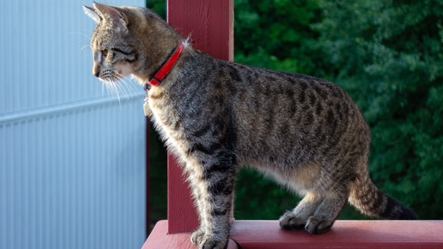
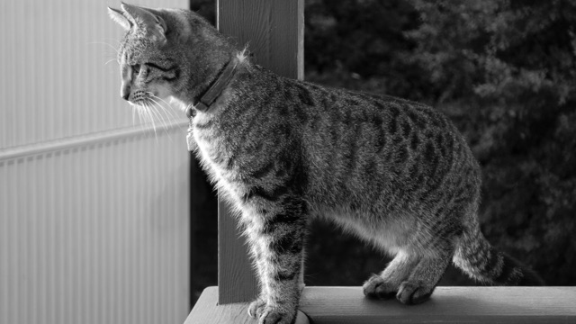
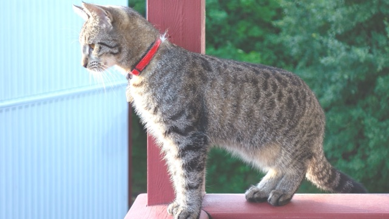

# pixelforge

[](https://github.com/Pamirus/pixelforge/actions/workflows/ci.yml)

A small command-line photo filter program, and a lab for measuring what modern C++ techniques really cost.

pixelforge loads a photo, applies filters such as grayscale, brightness, blur or threshold, and saves the result. The program is rewritten in stages. It starts as plain C with `malloc` and `free`, then moves through RAII, move semantics, views, templates, concepts, data layout, parallelism and lazy evaluation. Each stage gets a git tag (`v0`, `v1`, …) and a benchmark, so any two stages can be compared.

**Status:** v0, the C baseline, is done. Next is v1, an `Image` class built on RAII. The plan is in [docs/ROADMAP.md](docs/ROADMAP.md).

## Usage

The C baseline works today. Filters run in the order given:

```sh
build/baseline_c/pixelforge_c images/cat-4k.jpg out.jpg --grayscale --brightness 20
```

| Original | `--grayscale` | `--brightness 60` |
|---|---|---|
|  |  |  |

Photo: "Young tabby cat keeping watch" by W.carter, CC0 ([details](images/README.md)).

From v1 on, the C++ program `pixelforge` takes the same arguments and adds more filters:

```sh
pixelforge cat.png out.png --grayscale --brightness 20 --blur 5
```

## Building

Needs CMake 3.25 or newer and a C++20 compiler.

```sh
cmake -B build        # Release unless CMAKE_BUILD_TYPE says otherwise
cmake --build build
ctest --test-dir build --output-on-failure
```

The first configure downloads GoogleTest. Pass `-DPIXELFORGE_BUILD_TESTS=OFF` to skip the tests.

## Results

Time for one filter pass over the 3840 × 2160 photo (24.9 MB in memory), as the median of 200 runs:

```sh
build/baseline_c/pixelforge_c_bench images/cat-4k.jpg 200
```

| Tag | Version | Grayscale | Brightness |
|---|---|---|---|
| v0 | C, `malloc`/`free` | 6.2 ms | 3.1 ms |

Machine: Apple A18 Pro (6 cores, 8 GB), Apple Clang 21, Release build (`-O3`). On this laptop the same measurement varies by up to about 30% from run to run, so smaller differences mean nothing.

Grayscale takes about twice as long as brightness, although both touch the same 24.9 MB. Stage v8 looks into why.

## Third-party code

| Library | Used for | License |
|---|---|---|
| [stb_image, stb_image_write](https://github.com/nothings/stb) | Reading and writing PNG and JPEG, vendored in `third_party/stb` | MIT or public domain |
| [GoogleTest](https://github.com/google/googletest) 1.18.0 | Unit tests, downloaded at configure time | BSD 3-Clause |

## License

MIT. See [LICENSE](LICENSE).
