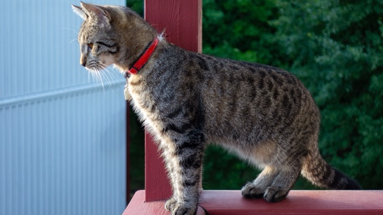

# pixelforge

[](https://github.com/Pamirus/pixelforge/actions/workflows/ci.yml)

A small command-line photo filter program, and a lab for measuring what modern C++ techniques really cost.

pixelforge loads a photo, applies filters such as grayscale, brightness, blur or threshold, and saves the result. The program is rewritten in stages. It starts as plain C with `malloc` and `free`, then moves through RAII, move semantics, views, templates, concepts, data layout, parallelism and lazy evaluation. Each stage gets a git tag (`v0`, `v1`, …) and a benchmark, so any two stages can be compared.

**Status:** v0 (the C baseline), v1 (an `Image` class built on RAII), v2 (copying versus moving), v3 (views, flips and rotation), v4 (templates for 8-bit and `float` pixels, box blur) and v5 (work moved to compile time) and v6 (concepts, compared with `std::enable_if`) are done. Next is v7: four ways to write one filter, with `virtual`, CRTP, `std::variant` and `std::function`. The plan is in [docs/ROADMAP.md](docs/ROADMAP.md).

## Usage

Filters run in the order given:

```sh
build/src/pixelforge images/cat-4k.jpg out.jpg --grayscale --brightness 20
```

| Option | Effect |
|---|---|
| `--grayscale` | Replaces R, G and B with their average |
| `--brightness N` | Adds N (−255 to 255) to every channel |
| `--negative` | Replaces every channel value v with 255 − v |
| `--threshold N` | Makes pixels with a gray level of at least N (0 to 255) white, the rest black |
| `--flip-horizontal` | Mirrors the image left to right |
| `--flip-vertical` | Mirrors the image top to bottom |
| `--rotate` | Turns the image 90° clockwise; repeat it for 180° or 270° |
| `--blur N` | Box blur: replaces each pixel with the average of the pixels up to N (1 to 10) away, a (2N+1) × (2N+1) square |
| `--time` | Prints how long loading, each filter and saving take |

The output format follows the extension: `.png`, `.jpg` or `.bmp`. The C baseline, `build/baseline_c/pixelforge_c`, takes the same arguments but has only grayscale and brightness.

| Original | `--grayscale` | `--brightness 60` |
|---|---|---|
|  |  |  |

| `--negative` | `--threshold 110` | `--blur 3` |
|---|---|---|
|  |  |  |

Photo: "Young tabby cat keeping watch" by W.carter, CC0 ([details](images/README.md)).

## Building

Needs CMake 3.25 or newer and a C++20 compiler.

```sh
cmake -B build        # Release unless CMAKE_BUILD_TYPE says otherwise
cmake --build build
ctest --test-dir build --output-on-failure
```

The first configure downloads GoogleTest and Google Benchmark. Pass `-DPIXELFORGE_BUILD_TESTS=OFF` or `-DPIXELFORGE_BUILD_BENCHMARKS=OFF` to skip them.

## Results

Machine: Apple A18 Pro (6 cores, 8 GB), Apple Clang 21, Release build (`-O3`). On this laptop timings vary from run to run and even more from day to day: on 2026-11-13 the v0 benchmark gave 6.2 ms and 3.1 ms. So only rows measured in the same session are compared, and a whole table is measured again whenever a row is added.

### Filters

Time for one filter pass over the 3840 × 2160 photo (24.9 MB in memory):

```sh
build/baseline_c/pixelforge_c_bench images/cat-4k.jpg 200   # v0
build/benchmarks/pixelforge_bench images/cat-4k.jpg 200      # v1 and later, built from that tag
```

| Tag | Version | Grayscale | Brightness |
|---|---|---|---|
| v0 | C, `malloc`/`free` | 6.3 ms | 3.0 ms |
| v1 | C++ `Image` class: RAII, `std::vector`, exceptions | 6.1 ms | 2.5 ms |
| v4 | The same filters as templates for 8-bit and `float` pixels | 6.2 ms | 2.5 ms |

Each benchmark run times 200 passes and reports their median. The three benchmarks were run one after the other, three times each, on 2026-11-20; the table shows the middle of the three medians. Another program kept one of the six cores busy throughout, and every row was 35 to 55% slower than on 2026-11-16, when v0 and v1 took 4.1 ms each for grayscale and 2.2 and 1.8 ms for brightness. The rows kept the same order. v2 and v3 did not change these two filters, so they have no rows here.

- **Grayscale** is the same in C and C++. Keeping the pixels in a class with a `std::vector` costs nothing measurable.
- **The v4 templates** cost nothing either. For 8-bit pixels the compiler turns them into exactly the same machine code as the v1 functions, instruction for instruction, so the v4 row differs from the v1 row only by noise.
- **Brightness** was 16 to 22% faster in C++ in every round. Both versions process 16 bytes at a time, but their inner loops differ. In C++, `std::clamp(v, 0, 255)` becomes one max and one min per vector. In C, the two `if`s in `clamp_to_byte` become a mask and extra shuffle steps: 23 instructions per 16 bytes instead of 19. That is the likely cause, and it comes from the code the compiler chose, not from the language. Stage v9 compares assembly in detail.
- **Grayscale takes more than twice as long as brightness**, although both touch the same 24.9 MB. The compiler did not vectorize the grayscale loop: it handles one 3-byte pixel per turn, while the brightness loop works on 16 bytes at a time. Stage v8 looks into why.

### Copying versus moving (v2)

```sh
build/benchmarks/pixelforge_benchmarks --benchmark_repetitions=5
```

| Operation on a 3840 × 2160 image (24.9 MB) | Time |
|---|---|
| Copy into a new image | 0.9 ms |
| Copy into an existing image of the same size | 1.0 ms |
| Copy into a new image, first time in a fresh process | 5.5 ms |
| Move to another image and back (two moves) | 1.5 ns |

Measured on 2026-11-18. The first-copy row is the median of five separate processes, which ranged from 3.8 to 9.2 ms; each other row is the middle of three runs of five repetitions. Between repetitions the times varied by 10 to 20%, so 0.9 and 1.0 ms count as the same.

- **A move costs about a nanosecond, whatever the image size.** It hands over a pointer and two sizes; the 24.9 MB stay where they are. A copy reads and writes all of them, which takes about a million times longer.
- **A repeated copy into a new image costs no more than one into an existing image**, although it allocates 24.9 MB each time. macOS's allocator keeps the large block the previous copy freed and hands it out again with its memory pages already in place. With that cache turned off (`MallocLargeCache=0`), the same copy took 2.75 ms.
- **The first copy in a process is the slow one.** Its memory is new, and the system sets up each 16 KB page the first time it is written: about 1,500 pages for one image.
- **Which returns copy and which move** is checked in [tests/return_value_test.cpp](tests/return_value_test.cpp). Returning a temporary or a single named image costs nothing; `return std::move(image)` costs a move; `return first ? a : b` costs a copy.

### Views, flips and rotation (v3)

```sh
build/benchmarks/pixelforge_benchmarks --benchmark_filter='crop|flip|rotate' --benchmark_repetitions=5
```

| Operation on a 3840 × 2160 image (24.9 MB) | Time |
|---|---|
| Crop the middle quarter as an `ImageView` | 2.8 ns |
| Copy that crop (1920 × 1080, 6.2 MB) into a new image | 0.33 ms |
| Flip top to bottom (`--flip-vertical`) | 0.72 ms |
| Flip left to right (`--flip-horizontal`) | 10.5 ms |
| Rotate 90° into a new image (`--rotate`) | 16.1 ms |

Measured on 2026-11-19; each row is the middle of three runs of five repetitions. Between the runs the same row varied by as much as 60% (the vertical flip took 0.67 to 1.05 ms), so the numbers are rough, but the gaps between the rows are much larger.

- **A crop costs a few nanoseconds, whatever its size.** It works out one pointer and checks four numbers. Copying the same region takes about 100,000 times longer, so a crop is copied only when it has to outlive the image or be saved on its own.
- **The two flips move the same 24.9 MB, but the vertical one is about 15 times faster.** It swaps whole rows, and the compiler turns that into 32-byte vector loads and stores. The horizontal flip swaps one 3-byte pixel at a time, with single-byte loads and stores. That is the likely cause; stage v8 measures it.
- **The rotation is the slowest, although it also reads and writes each byte once.** It builds each row of the result from a column of the image, so consecutive reads are a whole row (11,520 bytes) apart instead of next to each other. It also allocates the new image each time. Stage v8 is about this kind of memory access order.

### Pixel types and blur (v4)

```sh
build/benchmarks/pixelforge_benchmarks --benchmark_filter='grayscale|brightness|convert|blur' --benchmark_repetitions=5
```

| Operation on a 3840 × 2160 image | 8-bit pixels (24.9 MB) | `float` pixels (99.5 MB) |
|---|---|---|
| Grayscale | 6.1 ms | 5.7 ms |
| Brightness +20 | 2.7 ms | 3.8 ms |
| Convert into a new image of the other type | 5.2 ms | 5.6 ms |
| Box blur, radius 1 (3 × 3 window) | 74 ms | 67 ms |
| Box blur, radius 2 (5 × 5 window) | 210 ms | 170 ms |
| Box blur, radius 5 (11 × 11 window) | 840 ms | 850 ms |

Measured on 2026-11-20, right after the filter table above; each cell is the middle of three runs of five repetitions. Between the runs the same cell varied by as much as 65% (converting to 8-bit took 5.4 to 9.0 ms), so only large gaps mean something.

- **Grayscale takes no longer on `float` pixels, although they are four times the bytes.** The compiler vectorized neither version: both loops handle one pixel per turn, with three loads, the average and three stores. So the time follows the number of pixels, not the number of bytes.
- **Brightness is vectorized for both types and takes 40% longer on `float` pixels.** For four times the bytes, that is 26 GB/s instead of 9 GB/s.
- **Converting to `float` and back costs about 11 ms, nearly twice a grayscale pass.** That is worth paying for a chain of filters, converted once at each end, because no filter in the chain rounds its result; for one quick filter it is not.
- **The blur takes more than ten times as long as grayscale even at radius 1, and its time grows with the window, not the radius.** From radius 1 to 5 the window grows from 9 to 121 pixels and the time by 11 to 13 times. Every pixel reads its whole window, at just under 1 ns per neighbour. Stage v8 moves the border checks out of the inner loop.
- **The blur takes about as long on `float` pixels as on 8-bit ones**, so memory traffic is not what limits it; the work for each neighbour is.

### Compile time (v5)

```sh
build/benchmarks/pixelforge_benchmarks --benchmark_filter='blur|brightness' --benchmark_repetitions=5 --benchmark_enable_random_interleaving=true
```

| Operation on a 3840 × 2160 image | v4: chosen at run time | v5: fixed at compile time |
|---|---|---|
| Box blur 3 × 3, 8-bit pixels | 105 ms | 69 ms |
| Box blur 5 × 5, 8-bit pixels | 250 ms | 145 ms |
| Box blur 11 × 11, 8-bit pixels | 1,210 ms | 930 ms |
| Box blur 3 × 3, `float` pixels | 119 ms | 50 ms |
| Box blur 5 × 5, `float` pixels | 310 ms | 121 ms |
| Box blur 11 × 11, `float` pixels | 1,270 ms | 670 ms |
| Brightness +20, 8-bit pixels: computed, or looked up in a table | 4.7 ms | 11.9 ms |

The v4 column is `box_blur(image, radius)` and the computed brightness; the v5 column is `Blur<Size>` and `brightness_lookup`, whose table comes from the `constexpr` function `brightness_table`. Measured on 2026-11-21, shortly after midnight, while other programs kept about two of the six cores busy; each cell is the middle of three runs of five repetitions. So the times are higher than in the v4 table, and between runs the same cell varied by more than 80%. To keep the comparison fair, the repetitions of all rows ran in random order, and in every run each v5 blur was faster and the table slower than its v4 counterpart.

- **Fixing the blur size at compile time made the blur 1.3 to 2.6 times faster**, least for the largest window. For `Blur<3>` the compiler unrolls the whole 3 × 3 window: on 8-bit pixels its code has 33 single-byte loads, against 3 inside the loops of `box_blur`. Larger windows are unrolled only in part (18 loads for 11 × 11), and gain less. The price is that every size is separate code and must be known when the program is compiled, so `--blur N` keeps the run-time version.
- **The lookup table made brightness about 2.5 times slower.** The computed version is vectorized: it clamps 16 bytes at a time with one max and one min. A table lookup cannot be vectorized this way, so that loop loads each byte, loads its table entry and stores it, one byte at a time. Building the table takes 256 steps and does not matter. A table would pay off for a costlier formula per value, such as a gamma curve.

The differences between 8-bit and `float` channels, such as rounding and the largest value, live in one traits class, [channel_traits.hpp](include/pixelforge/detail/channel_traits.hpp). Up to v4 it had one specialization per type; v5 makes it a single template whose functions choose their 8-bit or `float` code with `if constexpr`. The compiler throws the other branch away, and the filters compile to the same object file as before, byte for byte.

For two types that differ in a few short functions, the `if constexpr` version reads better: each operation shows both versions next to each other, so the differences are easy to see. The specializations still have two advantages. Each type's rules are in one block, and the type aliases stay plain (`using Work = int;` instead of `std::conditional_t<is_8_bit, int, float>`). A third channel type, such as 16-bit, would also be a new specialization that leaves the others alone, while with `if constexpr` it would add a branch to every function.

### Concepts (v6)

The filter chain `apply(image, filters...)` accepts only types that have a `const` member `apply(image)`. It is written twice: `apply_enable_if` with `std::enable_if` and a `std::void_t` trait, and `apply` with the concept `FilterFor<F, T>`. Tests check at compile time that both accept and reject exactly the same types.

What differs is what the compiler says about a wrong call. Apple Clang 21 names the failing filter and the reason for the concept version (`no member named 'apply' in 'NotAFilter'`), and only the filter for the `enable_if` one. g++ 15.2 reports the concept as one unit over all the filters, without the filter or the reason, but still better than the `enable_if` version, which ends inside `<type_traits>` with `no type named 'type' in 'struct std::enable_if<false, void>'`. So the difference between the two compilers was larger than the difference between the two techniques. The messages and a script to reproduce them are in [docs/error-messages](docs/error-messages/README.md).

## Third-party code

| Library | Used for | License |
|---|---|---|
| [stb_image, stb_image_write](https://github.com/nothings/stb) | Reading and writing PNG and JPEG, vendored in `third_party/stb` | MIT or public domain |
| [GoogleTest](https://github.com/google/googletest) 1.18.0 | Unit tests, downloaded at configure time | BSD 3-Clause |
| [Google Benchmark](https://github.com/google/benchmark) 1.10.0 | Microbenchmarks, downloaded at configure time | Apache 2.0 |

## License

MIT. See [LICENSE](LICENSE).
